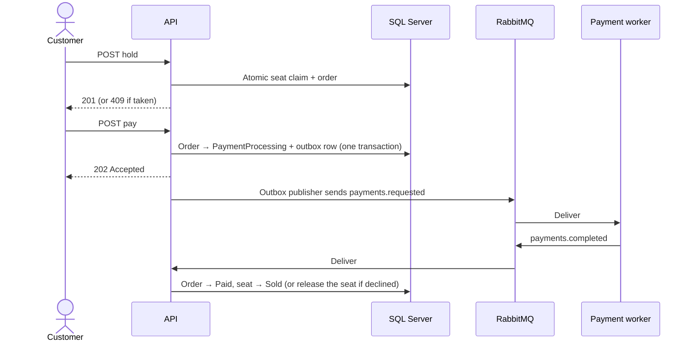

# Ticketing API

A concert-ticketing backend built on .NET 10 whose main job is to never sell the same seat twice, even when hundreds of people click at the same moment.

Customers browse events, hold a seat for 10 minutes and pay through a simulated payment service. Unpaid holds expire and the seat goes back on sale.

**Stack:** C#, ASP.NET Core, EF Core, SQL Server, RabbitMQ, JWT auth, xUnit, Testcontainers, Docker. A GitHub Actions workflow is included, but it hasn't run yet.

## Load test: 500 concurrent requests for one seat, 0 double bookings

500 different logged-in customers request the same seat at the same moment, over real HTTP. The tool then checks the database directly, so it doesn't rely on what the API reported.

| Round | Requests | 201 Held | 409 Refused | Other | Live orders in DB | p50 ms | p95 ms | p99 ms |
|---|---|---|---|---|---|---|---|---|
| 1 | 500 | 1 | 499 | 0 | 1 | 496 | 601 | 609 |
| 2 | 500 | 1 | 499 | 0 | 1 | 125 | 172 | 179 |
| 3 | 500 | 1 | 499 | 0 | 1 | 100 | 146 | 147 |
| 4 | 500 | 1 | 499 | 0 | 1 | 74 | 100 | 107 |
| 5 | 500 | 1 | 499 | 0 | 1 | 68 | 101 | 102 |

Measured on one desktop PC with the whole system in Docker and the load generator on the same machine. Early rounds are consistently slower, probably from opening the 500 connections. Latencies are local and aren't a production capacity claim.

**At 2,000 concurrent requests per seat**, with the API running directly on the host, all 4 rounds had exactly 1 winner, 1,999 refusals and 0 errors. Through Docker Desktop's port forwarding, about 30 connections per round were reset in later rounds, so the load tool reports `FAILED` for those runs. The seat outcome stayed correct and the API logged no failures.

**Can this test actually fail?** Yes. `NaiveControlTest` swaps in the obvious "read the seat, then write it" code and removes the database constraint. Across repeated runs of 100 concurrent requests for one seat, it gave that seat to **between 4 and 19 customers**. The real code, under the same 100-request test, gives it to exactly 1.

## How double booking is prevented

There are two independent layers, and each has its own test that passes without relying on the other:

1. **One atomic claim.** The race is decided by a single conditional `UPDATE`, in [`SeatHoldService`](src/Ticketing.Api/Services/SeatHoldService.cs):

   ```sql
   UPDATE Seats SET Status = Held, CurrentOrderId = @order
   WHERE Id = @seat AND EventId = @event AND Status = Available
   ```

   SQL Server serialises writers on the row, so exactly one request affects a row. The rest affect zero rows and get `409 Conflict`. There's no gap between checking and writing, which is the bug in the naive version. A cheap read before this turns most requests away quickly, but it never grants a seat.

2. **A database constraint.** A filtered unique index on `Orders(SeatId)`, covering only live statuses, makes a second live order for a seat impossible, even if the application has a bug.

## How a booking flows



- **Transactional outbox.** The payment message is saved in the same transaction as the order change, so a crash can't leave a paid-for order with no message, or a message with no order. `UPDLOCK, READPAST` lets several API instances publish without claiming the same rows.
- **At-least-once delivery.** Messages use broker confirms and manual acks. Result handling is a conditional update, so a duplicate delivery changes nothing.
- **Hold expiry.** A background sweep frees overdue holds. Expiring and starting payment both require `Status = Pending`, so they can't both win.

## What happens when things go wrong

| Failure | Behaviour | Checked by |
|---|---|---|
| RabbitMQ restarts | Publisher and consumers reconnect | `tools/broker-restart-check.ps1` |
| SQL Server is down when a result arrives | The result stays queued and applies once the database returns | `tools/sql-outage-check.ps1` |
| A message is malformed | It moves straight to a `.dead` queue for inspection | Integration test |
| A payment result never arrives | After a configurable timeout (15 minutes by default), the order fails and the seat goes back on sale | Integration test, with the wait simulated |
| A success arrives after that timeout | The order stays failed, and an error flags a refund | Integration test |
| A payment request waits too long | The worker refuses to charge, and a timeout cancels any request not yet sent | Integration test |
| The same result arrives twice | The second one changes nothing | Integration test |
| Two API instances publish together | Each message is sent once | Integration test, timing-dependent |
| Expiry races a payment | One wins, and the order and seat always agree | Integration test, timing-dependent |

Messages already queued also survived a full `docker compose down` and `up`, checked by hand.

## Run it

The quickest way needs only Docker, and serves the API on `http://localhost:5080`:

```bash
docker compose --profile app up -d --build --wait
```

To run the API and worker from source, you need the .NET 10 SDK and Docker:

```bash
docker compose up -d --wait
dotnet run -c Release --project src/Ticketing.Api --urls http://localhost:5080
dotnet run -c Release --project src/Ticketing.PaymentWorker
```

Set `ASPNETCORE_ENVIRONMENT=Development` and `DOTNET_ENVIRONMENT=Development` first, so the local settings load. Those settings contain development-only passwords and keys. Real deployments must supply their own through environment variables.

Run the tests (Docker must be running):

```bash
dotnet test Ticketing.slnx --filter "Category!=Control"
```

That runs 28 tests. A 29th, the naive control, needs `--filter "Category=Control"` and is excluded because it depends on a real race.

Run the load test, with the API running:

```bash
dotnet run -c Release --project tools/Ticketing.LoadTest -- --requests 500 --rounds 5
```

With the full Docker stack running, `tools/broker-restart-check.ps1` and `tools/sql-outage-check.ps1` exercise the failure cases above.

## API

| Method | Route | Access | Purpose |
|---|---|---|---|
| POST | `/api/auth/register`, `/api/auth/login` | Public, rate limited | Get a JWT |
| GET | `/api/events?page=&pageSize=`, `/api/events/{id}` | Public | List upcoming events, and view any event's seats |
| POST | `/api/events` | Admin | Create an event |
| POST | `/api/events/{eventId}/seats/{seatId}/hold` | Customer | Hold a seat for 10 minutes |
| GET | `/api/orders`, `/api/orders/{id}` | Owner | View your orders |
| POST | `/api/orders/{id}/pay` | Owner | Start payment. Use `tok_declined` to simulate a declined card |
| GET | `/health`, `/health/ready` | Public | Process is alive, and database is reachable |

## Known limits

- Payments are simulated. A real provider would receive `OrderId` as its idempotency key, so a redelivered message couldn't charge twice.
- An order holds one seat. Multi-seat orders would need to claim all seats in one transaction, in a consistent order, to avoid deadlocks.
- Nothing replays or alerts on dead-lettered messages yet.
- A valid message that keeps failing for a reason other than an outage retries every few seconds and blocks its queue, so nothing is lost but it needs an alert.
- The login limit defaults to 20 requests per minute. The local settings, which the Docker setup also uses, raise it so the load test can register customers.
- One customer can hold any number of seats. A real sale would cap this per customer.
- Rate limiting uses the client address, so behind a reverse proxy it needs forwarded-header support.
